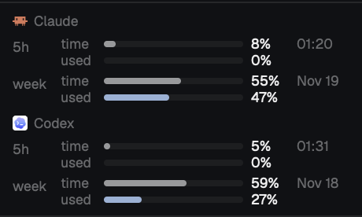

# herdr-agent-rate

A [Herdr](https://herdr.dev) mod that shows the 5-hour and weekly rate limits of Claude Code and Codex as bars, and `agent-rate`, the small program that gets those limits where the mod can read them.



Each window has two bars. The top one is how much of the window has gone by, with the time it resets; the bottom one is how much of the limit you have used. When usage gets ahead of time, the usage bar turns red: at this pace you run out before the window resets.

## How the numbers get there

- **Claude**: Claude Code passes `rate_limits` to its status line command on every reply. With `agent-rate statusline` as that command, it prints a status line and writes them to `~/.cache/claude/rate-limits.json`. The mod reads that file.
- **Codex**: Codex writes `rate_limits` into its session logs (`~/.codex/sessions/**/rollout-*.jsonl`, or under `$CODEX_HOME`). The mod runs `agent-rate codex`, which prints the last ones from the newest logs.

The mod reads both every 10 seconds. The limits are your account's, so any session updates them, but only when it gets a reply: a window shows `—` once it has reset and no session has replied since, and so does a source the mod can't read.

There is one file for Claude, and every Claude Code that runs `agent-rate statusline` overwrites it. If you use Claude Code with more than one account (another `CLAUDE_CONFIG_DIR`, say), they take turns writing their own limits, and the bars jump between them. Use `agent-rate statusline` with only one of them.

## Requirements

- Herdr (tested with herdr-app 0.1.15 on macOS). The mod runs no shell, so the same files work on macOS, Linux and Windows.
- `agent-rate` on your `PATH`: the prebuilt binary (macOS arm64, Linux x86_64 and arm64, Windows x86_64) or the Ruby script (Ruby 3.4 or later, standard library only).
- Claude Code and/or Codex CLI. Their icons are the ones Herdr ships in `~/.config/herdr-app/icons`.

## Install

### agent-rate

Each release has an archive per platform with the `agent-rate` binary, `LICENSE`, and `THIRD_PARTY_NOTICES`:

```sh
gh release download --repo hoshinotsuyoshi/herdr-agent-rate --pattern '*-darwin-arm64.tar.gz' --pattern SHA256SUMS
shasum -a 256 --ignore-missing -c SHA256SUMS
tar xzf agent-rate-*-darwin-arm64.tar.gz
install -m 755 agent-rate-*-darwin-arm64/agent-rate ~/.local/bin/agent-rate   # anywhere on your PATH
```

- Linux: `'*-linux-x86_64.tar.gz'` or `'*-linux-arm64.tar.gz'`, and `sha256sum --ignore-missing -c SHA256SUMS`. The binaries link glibc dynamically and need a glibc at least as new as Ubuntu 22.04's.
- Windows: `'*-windows-x86_64.tar.gz'`. `tar xzf` works in PowerShell too; put `agent-rate.exe` in a folder on your `PATH`. It needs no DLL beyond Windows' own. Spinel's native Windows support is community-maintained, so this binary is the least tried of the four.

Or use the Ruby script: `ln -s "$PWD/herdr-agent-rate/bin/agent-rate" ~/.local/bin/agent-rate`.

Herdr runs `agent-rate` with your login shell's `PATH`. If that doesn't have it (an interactive shell's `PATH` may, a login shell's not), the mod also tries `~/.local/bin/agent-rate`.

### The Claude status line

Set it in `~/.claude/settings.json`:

```json
{ "statusLine": { "type": "command", "command": "agent-rate statusline" } }
```

It prints `<model> | ctx <used>k / <size>k (<percent>%)`. If the status line stays empty, Claude Code can't find `agent-rate` on its `PATH`: write the full path instead, such as `~/.local/bin/agent-rate statusline`. If you already have a status line you like, keep it and add only the part that saves the limits, for example with jq:

```sh
input=$(cat)
rate=$(printf '%s' "$input" | jq -c 'select(.rate_limits != null) | .rate_limits + {updated_at: now | floor}')
if [ -n "$rate" ]; then
  mkdir -p ~/.cache/claude && printf '%s\n' "$rate" > ~/.cache/claude/rate-limits.json.$$ &&
    mv ~/.cache/claude/rate-limits.json.$$ ~/.cache/claude/rate-limits.json
fi
```

Codex needs nothing set up.

### The mod

Ask the agent in Herdr to add it: give it `herdr.dev/mods/hoshinotsuyoshi/herdr-agent-rate` or this repo's URL. Or by hand:

```sh
git clone https://github.com/hoshinotsuyoshi/herdr-agent-rate.git
cp -R herdr-agent-rate/mods/agent-rate ~/.config/herdr-app/mods/agent-rate
```

Then put it in your layout (`~/.config/herdr-app/layouts/<name>.json`). It is drawn for a sidebar column (268px wide in the preview) and needs about 170px of height, for example at the bottom of the sidebar:

```json
{ "id": "agent-rate", "type": "block", "content": { "mod": "agent-rate" }, "size": { "px": 170 } }
```

## The binary

`agent-rate` is compiled from `bin/agent-rate` with [Spinel](https://github.com/matz/spinel) (the version is in `.spinel-version`), and CI runs the same tests on the script and the binaries. The status line runs on every reply and the mod runs `agent-rate codex` every 10 seconds, so starting fast matters. On macOS arm64 (mean of 50 runs) `statusline` takes about 2 ms against about 80 ms for the Ruby script (and about 13 ms for a `sh` script with two `jq`s), and `codex` about 10 ms against about 140 ms.

## Development

```sh
ruby test/agent_rate_test.rb
script/build-spinel.sh .spinel   # Spinel at .spinel-version, built in .spinel
.spinel/bin/spinel bin/agent-rate -o agent-rate && AR_BIN=./agent-rate ruby test/agent_rate_test.rb
herdr-app check mods/agent-rate
```

Pushing a tag `v*` builds the binaries and creates a release. CI builds macOS only on manual runs.

GitHub Actions dependencies, including the ones `.github/actions/build` uses (referenced as `$/.github/actions/build`), are pinned in `.github/workflows/actions.lock`. After changing a `uses:`, run `gh actions-lock` ([gh-actions-lock](https://github.com/github/gh-actions-lock)) to update it.

## License

MIT License, see [LICENSE](LICENSE). The prebuilt binaries also contain the Spinel runtime and parts of the libraries Spinel compiles into them; their licenses are in [THIRD_PARTY_NOTICES](THIRD_PARTY_NOTICES).
