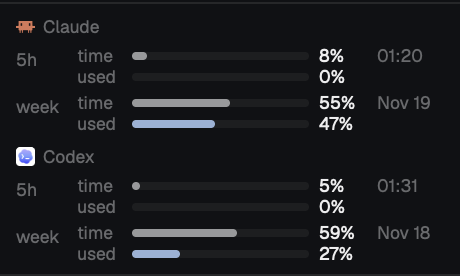

# Rate

A strip at the bottom of the sidebar with the 5-hour and weekly rate limits of Claude Code and Codex. Each window has a "time" bar (how much of the window has gone by) over a "used" bar (how much of the limit is used); when used gets ahead of time, the used bar turns red.

## What you see

A block about 170px high across the sidebar (268px wide in the preview), on the `chrome` background with a 1px `border` line on top. Padding 14px left and right, 6px top and bottom; text is 11px. Two sections, top to bottom, 5px apart and centered vertically:

1. **Claude**: a header row with the Claude icon (12px, in its own colors) and "Claude" in `dim`, 5px apart. Under it, two groups 3px apart: "5h" and "week".
2. **Codex**: the same with the Codex icon and "Codex".

Each group is a row: its label ("5h" / "week", 30px wide, `dim`) and, 8px to the right, two bars stacked (13px tall each):

- **time**: "time" (28px, `dim`), a track (5px tall, radius 3, `hover`) filled with `muted` to the percent, the percent as an integer (30px, `foreground`), and the reset time (40px, `dim`): `HH:MM` for 5h, `Nov 19` (English month, then the day) for week, in local time.
- **used**: "used", a track filled with `accent` to the percent (`blocked` when used is greater than time, and the percent text turns `blocked` too), the percent, and nothing on the right.

A window with no value, or whose reset time has passed, shows empty tracks and "—" in `dim` for both percents.

## How it behaves

- Reads both sources when it starts and every 10 seconds after that, and redraws each time, so the time bars move even when nothing new arrives.
- Time percent = 100 − (resets_at − now) / window length × 100, clamped to 0–100. Window lengths: 5h = 18000 s, week = 604800 s. Used percent is the source's, clamped to 0–100.
- No clicks, keys or hovers.
- The values are the account's: any session of that tool updates them, but only when it gets a reply. After a reset, the window shows "—" until a session replies again.

## Built from

- One mod, `mods/rate/` (`mod.json`: `"place": "none"`, title "Claude / Codex rate limits"), placed by the layout as a block: `{ "type": "block", "content": { "mod": "rate" }, "size": { "px": 170 } }`. No props.
- `gpui-kit` (`View`, `div`, `image`), `gpui-base` (`h_flex`, `v_flex`), `herdr` (`exec`, `theme`). Theme colors: `chrome`, `border`, `dim`, `muted`, `accent`, `blocked`, `foreground`, `hover`.
- `cx.timer.every(10000, ...)` and `cx.spawn` reading each source in turn, then `cx.notify()`. No shell, so it runs the same on macOS, Linux and Windows.
- Icons are Herdr's own `icons/claude.svg` and `icons/codex.svg`, drawn with `image(...)` (they are in color).
- Claude source: `readTextFile(`${home()}/.cache/claude/rate-limits.json`)`, a JSON object `{ "five_hour": { "used_percentage", "resets_at" }, "seven_day": { ... }, "updated_at" }` (`resets_at` in Unix seconds). Herdr doesn't write it: the Claude Code status line command must. This repo's `agent-rate statusline` does (or the jq snippet in the README).
- Codex source: `exec("agent-rate", ["codex"], { timeout: 10000 })`, and when that rejects (not on the login shell's PATH), `${home()}/.local/bin/agent-rate`; whose stdout is already in the Claude shape (`{}` when there is none). `agent-rate` (`bin/agent-rate`, prebuilt with Spinel) looks at the 5 most recently written `rollout-*.jsonl` under `$CODEX_HOME` or `~/.codex` (`sessions/YYYY/MM/DD/`); from the first that has one, it takes the last line containing `"rate_limits":{`. That line is `{ "payload": { "rate_limits": { "primary": { "used_percent", "window_minutes", "resets_at" }, "secondary": { ... } } } }`; `window_minutes` 300 is the 5h window and 10080 the week. The mod can't do this itself: the logs are bigger than `readTextFile`'s 1 MiB and there is no folder listing.

## Watch out

- A window whose `resets_at` has passed must show "—", not the old percent: the tool has started counting from 0 but nothing has told the mod yet.
- Codex's newest log may have no `rate_limits` yet (a session that just started), so look at more than one file. Match `"rate_limits":{` so that only lines with an object count.
- Codex names the windows primary / secondary; tell them apart by `window_minutes`, not by order.
- Bars and text need fixed widths (28 / 30 / 40px) or the tracks don't line up across rows.
- Write the week's date with the English month (`Nov 19`), not `11/19`: in much of the world that reads day first.
- Any read or parse failure shows "—" for that source; it must not stop the other one.
- 74px is enough for one source only; with both it needs about 170px.

## Done when

- `herdr-app check mods/rate` passes.
- With `~/.cache/claude/rate-limits.json` holding a future `resets_at`, Claude's bars show the percents and the reset time; set `used_percentage` above the time percent and the used bar and its number turn red.
- After a Codex reply, the Codex percents match the last `rate_limits` in the newest rollout log.
- With the file missing, or `resets_at` in the past, that window shows "—" and empty tracks.
